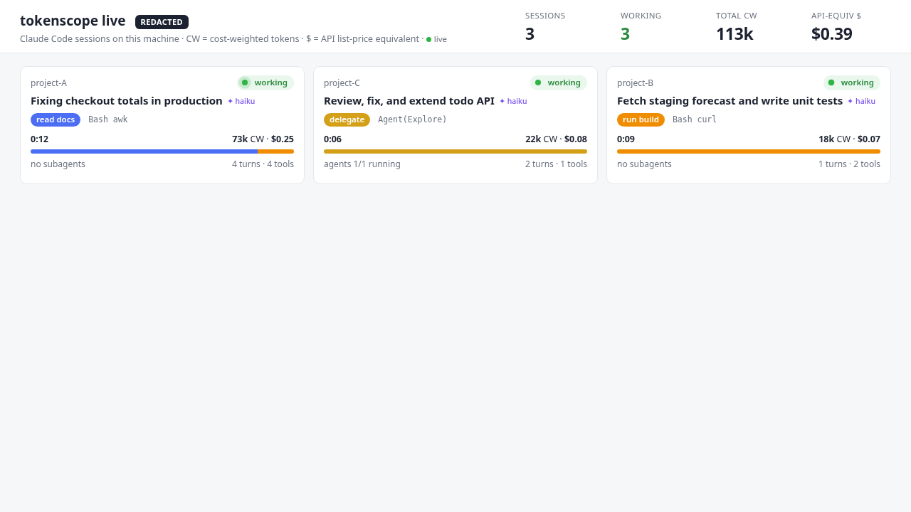
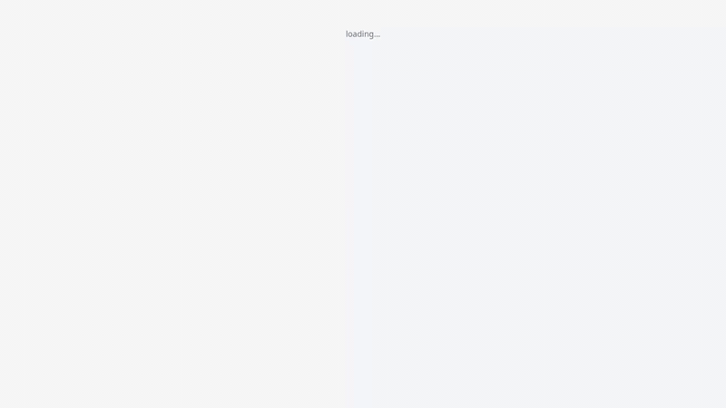
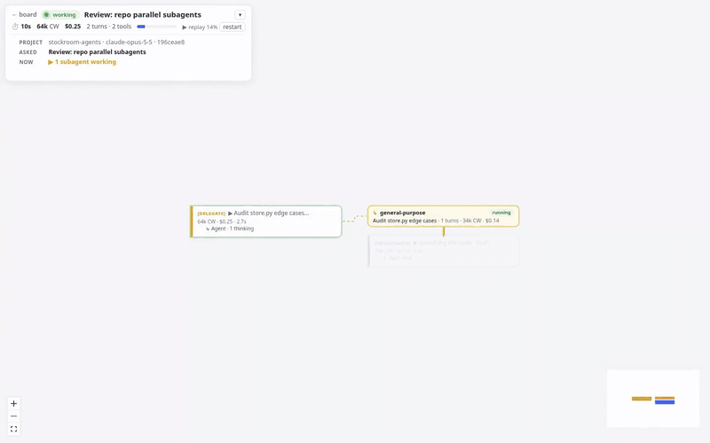
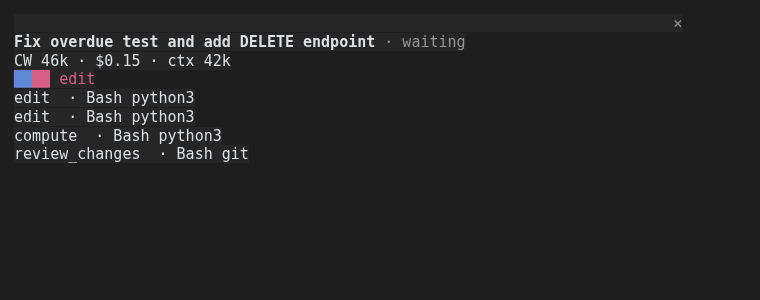
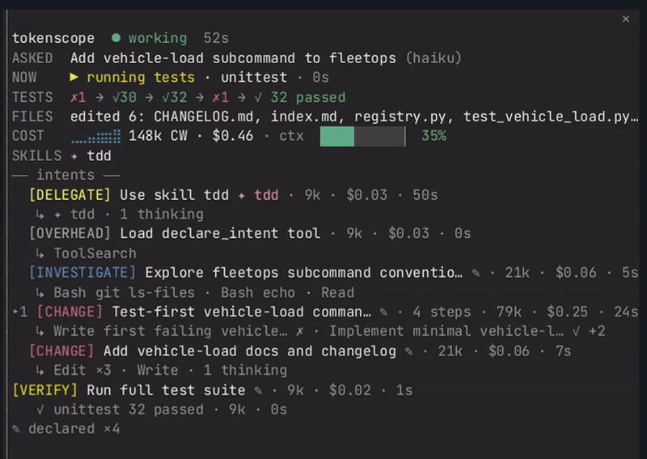
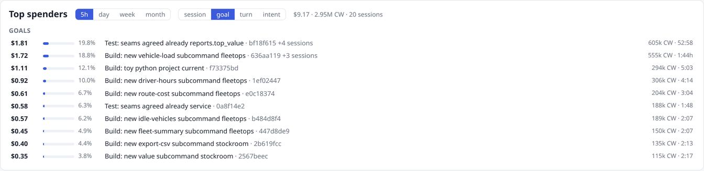

# tokenscope

> I was tired of hitting session limits without knowing why, so I made it explicit.

`tokenscope` reads your local Claude Code transcripts and explains where the tokens went: which calls spiked, which
file read or command output caused it, how much of it was re-read on every later call, and what you could change
next time. It is a single Python package, standard library only, and writes self-contained HTML reports
(no network, no external assets).

It also has a **live mode**: a local board of your running Claude Code sessions and a per-session infinite canvas where
the goal -> intent -> tool flow builds up as the agent works, plus an optional in-terminal pane (a Claude Code mod), and
a **top spenders** view: the costliest sessions, goals, prompts or intents of the last 5 h, day, week or month.

## Live: watch sessions as they happen





*Session view, replayed with `?replay=1`: intents and steps appear as the agent works; the recap overlay shows while
the session waits for you.*



*Subagents branch off the step that launched them as their own flows (parallel fan-outs side by side) and rejoin the
main flow when they return.*

```sh
./bin/tokenscope live            # http://127.0.0.1:8765/  (redaction ON by default)
```

`tokenscope live` tails `~/.claude/projects/**/*.jsonl` incrementally (byte offsets, partial lines buffered,
truncation handled) and shows:

- **Board** (`/`, the landing page): every live or recent session (last 6 h) as a card in a stable order (by start;
  cards never jump as costs change, one moves to the end only when its session ends), next to the
  top-spenders panel: project (masked as `project-A` … unless `--no-redact`), what was asked (the goal, plus `↳` the
  latest follow-up), status (working / waiting for you / idle, `done` once a SessionEnd hook fired), current intent,
  what it is doing now (`▶` the running call and its target, extension only when redacted, with a ticking timer; else
  the last step), elapsed time, cost-weighted tokens and API-equivalent $ so far with a cost-per-turn sparkline, intent
  mix bar, subagents running, the skills used and the live warnings (an amber dot by the project, hover for the
  text, plus the chips). Updates over SSE (polling fallback). Click a card to open its canvas; `← all sessions` on the
  canvas comes back. ☆ on a card pins it to the follow view (up to 4).
- **Follow view** (`/follow?s=<id>,<id>,...`): up to 4 pinned sessions side by side (a 2x2 grid that adapts to 1-3),
  each a compact live flow of its latest steps ([CATEGORY] label, $ and wall time per step) with the running total $,
  status (running / waiting / idle / ended) and the call running now, auto-scrolling to the newest step (scroll up to
  stop, `↓ latest` resumes). While a subagent runs, its branch stays pinned in view: the finished main-thread steps
  around it fold into one `… N earlier steps · $X` line, finished older branches show as one header line (click
  either to open it), and the tile scrolls so the running branches and the latest step both show. Pins are kept in the browser (localStorage) and in the URL, which wins when it names
  sessions, so a follow view can be bookmarked. `+ add session` picks another running session; a tile opens the
  canvas. One `/api/follow` request feeds all tiles.
- **Session view** (`/s/<id>`): the session as an infinite canvas (pan, zoom, minimap, fit view). One node per
  intent group or step ([CATEGORY] label, CW, $, wall time, a one-line summary, ✦ skills, ✎ declared), top-down in
  time order; each subagent branches off the step that launched it as its own flow of intents (parallel fan-outs side
  by side, nested ones further right) and rejoins the main flow when it returns. Click a node for its steps and tool
  calls (target, CW, time, ✓ / ✗, test counts) in a side panel. The view follows the live node; pan or zoom and it
  stops, "follow live" resumes. Overlays (collapsible): ASKED / NOW / TESTS / FILES / SKILLS rows with totals and a
  context gauge, and the idle recap (costliest and slowest intent, up to 3 hints, cross-session ones marked) while the
  session waits for you. `?replay=1` replays a recorded session server-side as if it were live (about 90 s;
  `&duration=<s>`). The canvas is a vendored React Flow build (`web/canvas/`, licences in THIRD_PARTY_NOTICES.md).
- **Live warnings** (rare by design; a normal fail -> edit -> fail -> edit -> green session shows none; each comes
  with a short hint): `stuck_error` (the same normalised error 3+ times with no edit in between, per thread),
  `reread_loop` (the same file read in full 4+ times with no edit to it and no compaction in between),
  `browser_loop` (20+ consecutive browser turns), `context_near_full` (>= 85% of the 200k / 1M context window).
  `python3 tools/eval_warnings.py --root ~/.claude/projects --show` replays your transcripts offline and shows how
  often each rule fires.

Options: `--root DIR`, `--project GLOB` (only matching project dirs, e.g. `'*myrepo*'`), `--since-minutes N` (which
existing transcripts to pick up at start, default 120), `--port`, `--host` (default 127.0.0.1), `--no-redact`,
`--haiku` (name goals with `claude -p --model haiku` from the *masked* first 240 prompt characters; off by default,
the default namer is a local keyword heuristic), `--haiku-odd` (the same, only for prompts that read oddly as a label:
long, multi-line, opening with filler, carrying paths, URLs, code or markup). Without either, such prompts are named
from their cleaned-up text, or by a Haiku name an earlier run cached (`~/.cache/tokenscope/goal-names.json`).

API: `GET /api/board`, `GET /api/top?window=5h|24h|7d|30d&by=session|goal|turn|intent`, `GET /api/follow?s=<id>,...`,
`GET /api/session/<id>[?since=<seq>]`, `GET /api/session/<id>/compact`, `GET /events` (Server-Sent Events: `board`
and `step`). See `docs/live-spec.md`.

**Status heuristic.** From transcripts alone: *working* while the last event is a prompt / tool call / tool result
and is less than 90 s old; *waiting* after the assistant ended its turn (for up to 30 min); *idle* after that. For
exact status (permission prompts, long-running tools, session end), add the optional hooks:

```sh
./bin/tokenscope live hooks      # prints a settings.json "hooks" block; merge it into ~/.claude/settings.json
                                 # or pass it per session: claude --settings hooks.json
```

The hook script is standard-library only, async, always exits 0, and writes only `{ts, event, session_id,
tool_name, notification_type, message (Notification only, 200 chars)}` to `~/.cache/tokenscope-live/events.jsonl`
(`$TOKENSCOPE_LIVE_EVENTS`). It never records prompts, tool inputs or tool outputs.

### Inside Claude Code: the mod and the status line





*The pane while the agent works, the `DONE · recap` box when it ends its turn, and the live view again on the next
prompt.*

- **Mod** (`mod/tokenscope-live/`, Claude Code mods, tested on Claude Code 2.1.296): adds a `/tokenscope` command that
  toggles a side pane in the terminal: ASKED (the goal from the first prompt, plus a `↳ now:` line for the latest
  follow-up, including ones typed while the agent works), NOW (the current call, or `N subagents working` with what
  the latest one is doing), TESTS (main-thread runs; `subagents:` when only subagents ran tests), edited files, a cost
  sparkline with CW / $ / context, and an intent list: labelled steps and intent groups (collapsed to one line, the
  live group expanded; `/tokenscope expand|collapse <n|all>` or a press on a group line), with the open step's
  provisional label dimmed. Every operation, step and group line ends with its wall time
  (`✓ unittest 22 passed · 3k · 4s`, `[CHANGE] Add X · 63k · $0.22 · 1m12s`; a narrow pane cuts the label, never the
  numbers). Skills show as `✦`: Skill-tool calls (`✦ skill:pr-review · 2k · 3s`), slash-command skills, a `✦ <name>`
  mark on the steps and groups they drove and a SKILLS row (`tools/skills_stats.py --root DIR` counts both kinds per
  skill across a transcripts tree). While the session waits for you a boxed recap sits right under the header
  (`━━ DONE · recap ━━`: costliest / slowest intent, then hints, the action first and its evidence under it); it is
  removed as soon as the agent works again. One recap hint may come from your other sessions (`cross-session:`):
  when the request you just finished repeats a workflow you did >= 3 times in >= 2 other sessions (same files, step
  shape and tools; each run >= 50k CW) and something would pay for itself, it says `➜ Make "change cli.py +
  README.md and test" a skill` (with a SKILL.md draft under `~/.cache/tokenscope/skill-drafts/`, never in a skills
  dir), `➜ Add a file map to CLAUDE.md` (a snippet under `~/.cache/tokenscope/claude-md-drafts/`) when the runs find
  the same files and the map nets more, `➜ Use skill /<name>` when one of your skills covers it, or `➜ Add a file
  map to skill /<name>` when the skill already ran every time and the runs still find their way to the same files.
  The saving is an estimate and shows both terms: `≈41k discovery/run − ≈9k skill body → ≈32k/run net`. Discovery
  is only what the remedy would have spared: full reads of the files it lists (not edited; a file the agent edits
  must be read anyway) and the searches and listings that led to them; a file map needs >= 3 stable files, a skill
  draft >= 2 shared steps and >= 3 files. The cost is what the skill body or file map
  adds to context on every later turn (cache reads), not once. It needs a net >= 20k and >= 30% of the discovery;
  with no net saving but the same steps every time it says `➜ Make "<name>" a skill for consistency` and that no
  token saving is expected. The index of past sessions (`--index-root DIR`, default `$TOKENSCOPE_INDEX_ROOT`
  or `~/.claude/projects`) is cached per transcript and built in the background; skills come from
  `~/.claude/skills`, `<project>/.claude/skills` and `--skills-dir DIR`; `--no-xhints` turns it off.
  `tools/eval_xhints.py --root DIR [--skills-dir DIR]` replays the history chronologically (each session only sees
  earlier ones) and writes a sample of firings for hand-checking. An older server without intents gets the phase tree instead (`/tokenscope view phases`
  shows it too): phases of same-group intents, tools under the newest phases, subagents by task description with
  nested subagents under the one that launched them. Rare warnings at the bottom. Polled once a second from the local server. Without the server it
  falls back to counters it computes from mod events (`tool.call`, `turn.step` usage, `turn.complete`).
  `claude --plugin-dir mod/tokenscope-live` (set `TOKENSCOPE_LIVE_PANE=1` to open the pane at start,
  `TOKENSCOPE_LIVE_BAND=1` for a one-line band above the prompt). See `mod/tokenscope-live/README.md`.
- **Status line**: `"statusLine": {"type": "command", "command": "python3 -m tokenscope.live.statusline"}` prints
  `◆ goal · intent · CW · $ · ⚠ flags` from the local server (empty when it is not running).

See `docs/claude-code-extensions.md` for what the mod / hooks / status line APIs can and cannot do.

## What it shows

Reports read top to bottom as **1 Understand → 2 Optimize → 3 Compare**.

- **Understand** (what the agent did): every session is split into requests (one per real user prompt), each request
  into steps (`Bash(./run_tests.sh) 13 failed`, `Edit src/pricing.js`, `Hook PostToolUse:Edit → 14 passed`, `Agent(Explore)`,
  `Skill(x)`, `MCP(server.tool)`), with an outcome inferred from transcript signals (success / failed / abandoned, plus
  looping and read-only flags). Requests are grouped into **goals discovered from the data** (what the prompts ask
  for and which files the agent touched; no fixed taxonomy), and goals into **areas**. Goals are named from their most
  distinctive terms + top file, or by one batched `claude -p --model haiku` call with `--name-with-claude`. You get a
  goals table (status Healthy / Costly / Failing / Looping, runs, finish %, median tokens), a tool-chain flow
  diagram by call position with transition %, the paths (chains) inside each goal with replayable example requests
  (tokens per step), context spend over time stacked by source, and an offered-vs-used card (skills, MCP, tools,
  CLAUDE.md imports).
- **Session view**: KPIs (all-in, new tokens, cache reads/writes, output, peak context, API-equivalent cost), a
  timeline with one bar per API call stacked by token type and the context size as a line, subagent calls hatched,
  cache misses / compactions / idle gaps marked, spikes labelled with their main cause, a "Spikes explained" list,
  a sortable turn table, breakdowns by tool, file, Bash output, MCP server and subagent, and an
  **offered vs used** panel (MCP servers, skills, subagent types that were listed in context but never used).
- **Cross-session view**: totals across sessions, a sortable session table with a keyword kind and top drain per
  session, the biggest single drain, groupings by project and kind, top drains over time (by tool, file, MCP server),
  aggregated offered-vs-used, and a collapsible full session view for the largest sessions.
- **Fixes**: rule-based suggestions computed from the analysis (large file reads, repeated reads, large Bash output,
  unused MCP servers / skills, cache misses, subagent fan-out, context bloat, system overhead). Each one comes with
  evidence, estimated savings (new tokens and all-in including carry) and a copy-pasteable action
  (a CLAUDE.md line or a `permissions.deny` entry).
- **Compare (sets)**: `tokenscope compare --a-sessions A.txt --b-sessions B.txt` compares two groups of runs per
  goal (medians + ranges, finish rate, same-prompt check, one-side-only check, top chain A vs B, hook fires per run,
  context by source A vs B, fixes that stopped triggering).
- **Compare**: a before/after view of two sessions (A and B): headline delta, KPI deltas, both timelines on the same
  scale, context overlay, top causes A vs B, which fixes from A no longer trigger in B, and a clear
  **"Prompts differ"** notice if the two first prompts are not the same.

## Install / run

Requires Python 3.11+. No dependencies.

```sh
git clone https://github.com/rstagi/tokenscope && cd tokenscope
./bin/tokenscope report -o report.html
```

or install the `tokenscope` command:

```sh
pipx install .     # or: pip install .
tokenscope report -o report.html --open
```

`python3 -m tokenscope ...` works too.

### macOS (and Linux)

By default tokenscope reads `~/.claude/projects`, which is where Claude Code keeps its transcripts on macOS and
Linux, so no configuration is needed:

```sh
./bin/tokenscope sessions
./bin/tokenscope report -o ~/Desktop/tokens.html --open
```

To read another directory (a copy, a different machine's export, test fixtures) use `--root DIR` on any subcommand,
or set `TOKENSCOPE_ROOT=DIR`.

## Usage

Every subcommand accepts `--root DIR` (default `~/.claude/projects`, or `$TOKENSCOPE_ROOT`). Session ids can be
given as any unique prefix (`764818da`).

Large corpora (thousands of subagent transcripts): every subcommand also accepts

- `--jobs N` – worker processes for per-session analysis (default `min(4, cpus)`, lowered when
  `/proc/meminfo` shows little free memory; about 0.6 GB per worker is assumed);
- `--no-cache` – skip the parsed-transcript cache. By default each transcript is parsed once into a compact form
  (big tool outputs cut to a 300-char head, plus a 3,000-char tail for Bash output, which test-summary parsing
  needs; original sizes kept) and pickled under `~/.cache/tokenscope/parsed/`, keyed by absolute path, size, mtime and
  tokenscope version. Delete the directory to clear it;
- `--sample N` (deterministic random sample of N sessions) and `--max-sessions N` (applied after `--sample`);
- `-v/--verbose` – one timing line on stderr: sessions, transcripts, calls, seconds, jobs, cache hits / misses, peak RSS.

`sessions --json` prints the listing as JSON.

### `sessions` – list sessions

```sh
tokenscope sessions [--project NAME] [--since 7d|24h|30m|2w|2026-10-01]
```

One line per session: id, project, start, calls (`*` = includes subagent calls), all-in tokens, kind (a keyword rule
on the first prompt: bugfix / feature / docs / ...), first prompt. Use `goals` for what the requests were actually for.
`--project` is a case-insensitive substring match on the project name.

### `top` – top spenders by time window

```sh
tokenscope top [--window 5h|24h|7d|30d] [--by session|goal|turn|intent] [--index-root DIR] [--now ISO] [--limit N] [--json]
python3 -m tokenscope top --window 5h --by goal
```



The costliest sessions, intents and steps of the last 5 h (the usage-limit window), day, week or month: $, share of
the window's $, CW, tokens, wall and active time. Only calls whose own timestamp falls in the window count, so a
session straddling its start is split. `--by` ranks something else instead: `session` (just the sessions), `goal`
(labelled user goals: a follow-up prompt stays in its goal, a session opened by one continues the project's latest
goal, so a goal can span turns and resumed sessions) or `turn` (one row per real user prompt, labelled with its text);
each row names its session's goal. Reads the cross-session index (cached per transcript). Also on the live board (a
"Top spenders" panel with window and grouping toggles, `GET /api/top?window=5h&by=goal`) and in the mod
(`/tokenscope top 5h`, `/tokenscope top 5h session`, `/tokenscope top 24h goal`; window and grouping are optional,
default `5h` and `intent`).

### `analyze` – one session in the terminal

```sh
tokenscope analyze SESSION [--json]
```

Totals (main / subagents / all), every call with its top causes, subagents, tools, files, big Bash outputs, cache
misses, compactions, idle gaps, offered vs used. `--json` dumps the full analysis.

### `report` – HTML report

```sh
tokenscope report [-o FILE] [--session SESSION] [--project NAME] [--since SPEC] [--open]
```

With `--session` you get the session view; otherwise the cross-session view of all sessions matching the filters.
Default output is `tokenscope-report.html`. `--open` opens the file in your default browser (best effort).

### `fixes` – suggestions

```sh
tokenscope fixes [--session SESSION] [--project NAME] [--since SPEC] [--json] [--emit-config DIR [--overlay]]
```

Prints the triggered fixes, sorted by estimated all-in savings. Across sessions, the same rule + target is merged.
`--emit-config DIR` writes `CLAUDE.md.suggested` and `settings.suggested.json` into `DIR`; it never touches your
real configuration – review and copy what you want.

With `--overlay`, files are written at their real repo-relative paths instead (`CLAUDE.md` with eager `@`
imports of big docs turned into on-demand pointers and long sections moved to `docs/claude/`, `.claude/settings.json`
merged with deny rules and noisy hooks wrapped by `.claude/hooks/tokenscope-cap.py`, plus `TOKENSCOPE_CHANGES.md`
explaining each change and listing what can't be applied automatically). Review, then `cp -r DIR/. <repo>`.

### `goals` – what the requests were for (`understand` is an alias)

```sh
tokenscope goals [--project NAME] [--since SPEC] [--session SESSION | --sessions FILE|ID,ID]
                 [--goal-threshold F] [--area-threshold F] [--name-with-claude] [--json]
```

Explains *what* happened before *where the tokens went*. Each session is split into **requests** (one per real user
prompt, including the subagent calls spawned inside it). Each request gets:

- **steps**: every tool use in order, with a normalized kind (`Read`, `Edit`, `Grep`, `Bash(./run_tests.sh)`,
  `Bash(git status)`, `Agent(Explore)`, `Skill(x)`, `MCP(server.tool)`, ...) and the hooks that fired after it
  (`Hook(PostToolUse:Edit)`), the analyzer's token attribution for its result, and parsed test results
  (node:test, pytest, jest/vitest, go test, mocha);
- a **chain**, the path the agent took (kinds with paths stripped, repeats collapsed:
  `Bash(cat) → Read×2 → Edit×3 → Hook(PostToolUse:Edit)×3`) and a coarse signature (the two most frequent kinds);
- the **files** it edited (Edit / Write / MultiEdit / NotebookEdit, plus Bash writes: `>` redirects, `tee`, `sed -i`,
  Python `open(f, 'w')`) and read (Read, Grep / Glob paths, `cat` / `head` / `sed -n` / `grep` targets in Bash);
- an **outcome** from transcript signals only: `success` (last test run passed, or no tests and a final answer),
  `failed` (last test run had failures, or the final step errored), `abandoned` (no final answer / ended mid-tool /
  interrupted / max turns), plus `looping` and `read_only` flags. The signals behind each outcome are listed.

Requests are then grouped into **goals**, and goals into **areas**, by clustering (see Methodology). The output lists
areas → goals (name, status, members, finish %, median all-in, top chain), then per goal its evidence: the member
prompts verbatim with their request ids and outcomes, files edited / read with counts, **why grouped** (the shared
features that contribute most to the goal's internal similarity, e.g. `file:src/money.js 0.13, text:'cents' 0.03`),
cohesion (mean pairwise similarity), the nearest other goal and its similarity, and the top paths with one replay
each. Status per goal: **Failing** (finish rate < 70%), **Looping** (≥ 1/3 of runs looping), **Costly** (median all-in
> 1.5× the median of all requests, or fixes claim > 30% of the goal's new tokens), else **Healthy**. The method
footer lists the weights, thresholds, every ignored file and the generic task words that were dropped. `--json` adds
the full evidence, flow data (step positions 1–6 with edges and percentages) and each API call's context split by
source (system prompt, tool definitions, skills, MCP listings used/unused, instructions, hook output, tool results,
user input, assistant history, other) per session, per run and per day.

`--goal-threshold` / `--area-threshold` change how eagerly requests merge into goals (default 0.52) and goals into
areas (default 0.16): lower = fewer, broader groups. `report` and `compare` take the same options.

Names default to the goal's most distinctive prompt terms + its top edited (or read) file, e.g.
`checkout total cents · src/money.js` (shown as "named from terms"). `--name-with-claude` sends ONE batched request
through your own `claude` CLI (`claude -p --model haiku`, falling back to the default model) with, per goal, up to 5
member prompts (first 240 characters), its top files, top 2 chains, distinctive terms and outcome mix, and asks for
specific verb-first goal names and short area names (generic names like "Fix a bug" are rejected). Names are cached in
`~/.cache/tokenscope/goal_names.json`, keyed by the goal's member prompts + edited files, so re-runs make no call and
stable goals keep their names; on any failure the names from terms are used and the reason is printed.
`--label-with-claude` is a deprecated alias.

### `compare` – before / after

```sh
tokenscope compare A B [-o FILE] [--open]
```

Prints a text comparison (A = before, B = after); with `-o` also writes the HTML comparison, and `--open` opens it.

```sh
tokenscope compare --a-sessions FILE|ID,ID --b-sessions FILE|ID,ID [-o FILE] [--report-link REPORT.html] [--name-with-claude]
```

Compares two sets of runs per goal. Goals are discovered on the union of A and B requests, so the same prompt lands in
the same goal on both sides; a goal with members on one side only is flagged and left out of the headline. You get a
headline (median all-in per run, finish rate), a "same prompts?" check per goal, medians and min–max of all-in,
new tokens, peak context and calls, the top tool chain and hook fires per run, context by source (per-run median),
and the fixes from A that no longer trigger in B. FILE holds one session id (or unique prefix) per line.

## Methodology

- **Measured vs estimated.** Per-call token counts are measured: they come from the API `usage` block recorded in
  the transcript (fresh input, cache write, cache read, output). Sizes of individual things inside a call (a tool
  result, a prompt, a listing) are not recorded, so they are **estimated** as characters / 4 and marked with `~`.
  When a call's measured new tokens are much larger than the estimates (dense logs and minified code tokenize
  worse than chars/4), the tool results in that call are scaled up to the measured value.
- **Dedupe by `message.id`.** One API response is written as several transcript lines that repeat the same usage;
  each `message.id` is counted once.
- **Headline: cost-weighted tokens + API-equivalent $.** Token types cost very different amounts, so the headline is
  *cost-weighted tokens* = input ×1 + cache write ×1.25 + cache read ×0.1 + output ×5 (the API price ratios relative
  to uncached input; constants in `tokenscope/pricing.py`) and the *API-equivalent $* from the price table in
  `tokenscope/pricing.py` (USD/MTok from platform.claude.com/docs/en/about-claude/pricing, fetched 2026-10-10; cache
  writes priced with their 5m / 1h split). Model ids match a table key exactly or with a date / `[1m]` suffix; other
  models (and `<synthetic>` lines) are *unpriced* and counted as such, never guessed. On a subscription this is not
  what you pay; it is what the same calls would cost on the API.
- **new, output, cache read, all-in.** Every KPI row shows *new* (uncached input + cache write), *output* and
  *cache read* as separate numbers. *all-in* (the plain sum incl. cache reads) is kept as a muted secondary figure:
  it is dominated by cache reads, which cost a tenth of an input token. (In goals, *new* per run also includes
  output, as before.)
- **Carry.** Whatever enters the context is re-read (as cache reads) by every later call of the same context until
  compaction. Fix savings lead with *new* tokens and *cost-weighted* tokens (new priced as cache writes, carry as
  cache reads) and $ when the model is priced; *all-in* = new + carry (carry = added tokens × later calls in the same
  context) stays as a detail.
- **Cache TTL.** The cache-write split in `usage.cache_creation` (5-minute vs 1-hour) tells which TTL was in effect.
  A cache miss (cache read falling below half of the previous context) after an idle gap longer than that TTL is
  blamed on expiry.
- **Subagents** are read from `<session>/subagents/**/agent-*.jsonl` at any depth (+ `.meta.json`: agentType,
  description, workflowPhase, spawnDepth) and linked to the call that spawned them. Transcripts under
  `subagents/workflows/wf_<id>/` carry that workflow id; each workflow's `journal.jsonl` is read for counts only
  (launched / started / results / failed, phases, agent ids; result payloads are never kept). They are separate API
  calls with their own context.
- **Request sources.** Each request (real prompt) is *human* or automated: *notification* (text starting with
  `<task-notification>`, `<system-reminder>`, `[SYSTEM`, `<command-`, local command output, ...), *hook* (an `origin`
  field that is not the user), *subagent* (subagent transcripts / `isSidechain`) and *headless* (`entrypoint` `sdk-*`
  or `promptSource: sdk`, i.e. `claude -p` / SDK; a person typing `claude -p` looks the same). `queue-operation`
  lines are not used: in the REPL a prompt typed while Claude is busy is queued too. Goals are discovered over human
  requests only (`--include-automated` adds the rest; when there are no human requests at all, all are used and the
  report says so). Counts per source are shown with the goals. The rules are in `tokenscope/parse.py`
  (`SOURCE_RULES`).
- **Persisted tool outputs.** When Claude Code saves a large tool output to disk, only a preview enters the context;
  tokenscope counts the preview and reports the full size separately.
- **Offered vs used** comes from transcript attachments that list deferred tool names, MCP server instructions,
  skills and subagent types. Limits: only what the transcript records is known; listing sizes are chars/4 estimates;
  MCP tool schemas are deferred (only names sit in context until a tool is loaded), so unused MCP servers are
  usually cheap and are only flagged when their listing is non-trivial; older transcripts may not record listings at
  all, in which case the panel says so.
- **Goals** are discovered, not classified. Each request's signature has feature groups: *text* (prompt words,
  lowercased, camelCase / snake_case / paths / dots split, English stopwords and generic task words such as
  please / make / add / fix / test / file / code dropped, light stemming of s / es / ing / ed, bare numbers dropped but
  identifiers like `SAVE10` kept), *files edited*, *files read*, *path tokens* (basenames without extension and
  directory names, plus `docs` for documentation files), *commands* (normalized Bash kinds and test runners) and
  *chain* bigrams (`Edit>Hook`). Each group is TF-IDF weighted (idf over requests) and L2-normalized; groups are
  combined with weights text 1.5, files edited 1.0, path tokens 0.6, files read 0.4, commands 0.2, chain 0.2 and
  compared by cosine (a group a request doesn't have, e.g. edits for an explain-only question, is left out instead of
  counting as a mismatch). Requests are merged by average-linkage agglomerative clustering while the similarity stays
  ≥ 0.52. Areas repeat this over goal centroids with files and paths emphasised (text 0.5, files edited 1.0, path
  tokens 1.0, path tokens of edited files 1.0, files read 0.6) at 0.16. The outcome is kept as evidence but is not a
  feature, so a goal is not split into its successes and its failures. Setup overhead is ignored and listed: files read
  by more than 80% of requests (once there are ≥ 5), the agent's own config (`CLAUDE.md`, `.claude/**`,
  `docs/claude/**`) and paths outside the repo. The session *kind* in listings is still a keyword rule on the first
  prompt.
- **Outcomes** come only from what the transcript records (test output, errors, stop reasons, interrupts); tokenscope
  does not know whether the change was actually right.

## Privacy

Everything runs 100% locally. tokenscope only reads the transcripts, read-only, and writes the files you ask for.
Nothing is sent anywhere, except with `--name-with-claude`, which sends, per goal, up to 5 prompt heads (240
characters), file names, chains and terms to Claude through your own `claude` CLI login. The reports, however, contain your prompts, file paths, commands and snippets of tool
output: don't share them blindly.

`tokenscope live` binds to 127.0.0.1 by default and redacts by default (prompts are not kept, projects / files / subagent
descriptions are masked, goal names come from masked text). Cross-session hints read your other local transcripts
and SKILL.md files and write only to `~/.cache/tokenscope/` (index cache, skill drafts). `--haiku` sends only the masked first 240 characters of a
session's prompts through your own `claude` CLI (`--haiku-odd`: only of prompts that read oddly as a label). The mod only fetches from the local server.

## Known limitations

- Goal discovery is unsupervised: two different features in the same files with few shared prompt words can merge,
  and two phrasings of one goal that share neither words nor files can split. The thresholds were tuned on two small
  demo projects; check "why grouped", cohesion and the nearest goal, and adjust `--goal-threshold` if needed.
- Per-cause numbers are estimates (chars/4, scaled to measured totals where possible); per-call totals are measured.
- The transcript schema varies between Claude Code versions; unknown fields are ignored and missing data is shown
  as unavailable, but some views may be incomplete on older or newer versions.
- How Max session limits weight cache reads versus other tokens isn't public, so tokenscope shows all-in and new
  tokens side by side instead of guessing a single "limit usage" number.
- The API-equivalent cost is Claude Code's own cost-state as recorded in the transcript, not a bill. On a
  subscription it is not what you pay.

## Repository layout

    bin/tokenscope              run without installing
    tokenscope/                 parser, analysis, goals, fixes, HTML reports, CLI
    tokenscope/intents.py       intent rules: tool call -> intent (locate, read_code, edit, test, ...) -> group
    tokenscope/xindex.py        cross-session index of past requests, matching, skill hints and drafts
    tokenscope/live/            live tailer, state + flags, goal namer, hook script, HTTP/SSE server, static UI
    mod/tokenscope-live/        Claude Code mod (in-terminal pane)
    docs/                       live design spec, notes on Claude Code extension points
    tests/                      unittest suite (`python3 -m unittest discover -s tests`), synthetic fixtures only

## Contributing

Issues and PRs welcome. Keep it standard-library only. Never commit real transcripts or reports made from them;
tests use synthetic fixtures (`tests/synth.py`, `tests/fixtures/`).

## License

MIT, see `LICENSE`.
